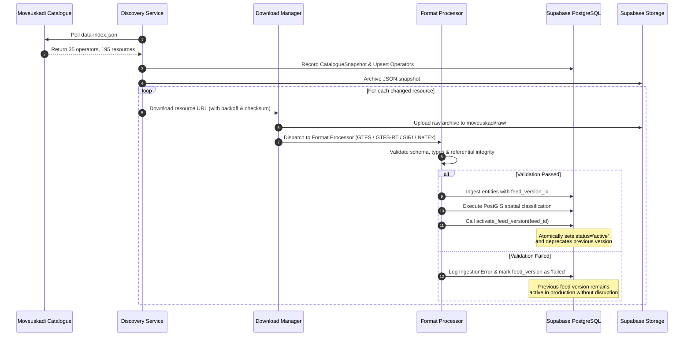

# Technical Architecture: Automated Euskadi Public Transport Data Platform

Comprehensive architecture, database design, spatial classification mechanics, and real-time telemetry processing across Bizkaia, Gipuzkoa, and Araba / Álava.

---

## 1. Executive Summary & Core Invariant

The **Automated Euskadi Public Transport Data Platform** is an enterprise data engine built for high-reliability public transit ingestion in the Basque Country (Euskadi), Spain. 

The primary invariant of the platform:
> **Zero hardcoded endpoints, zero manual downloads, and 100% dynamic discovery.**

All resources, transport operators, update timestamps, and direct URLs are discovered dynamically by querying the authoritative Open Data Euskadi / Moveuskadi index at:
```text
https://opendata.euskadi.eus/transport/moveuskadi/data-index.json
```
The catalogue currently hosts **35 transport operators** and **195 distinct data resources** across four primary formats: GTFS Static, GTFS-RT, SIRI XML, and NeTEx.

---

## 2. High-Level System Architecture

```
┌────────────────────────────────────────────────────────────────────────┐
│                   Moveuskadi / Open Data Euskadi                       │
│  - data-index.json (35 Operators, 195 Resources)                       │
│  - GTFS Static (.zip), GTFS-RT (.pb), SIRI (.xml), NeTEx (.zip)        │
│  - GeoEuskadi Administrative Boundaries (TERRITORIOS_5000_ETRS89.zip)  │
└──────────────────────────────────┬─────────────────────────────────────┘
                                   │ HTTP/TLS (Backoff & Checksums)
                                   ▼
┌────────────────────────────────────────────────────────────────────────┐
│                   Python Ingestion Worker (Docker)                     │
│  ┌──────────────────────┐  ┌─────────────────────┐  ┌───────────────┐  │
│  │  Catalog Discovery   │  │  Download Manager   │  │  Storage Svc  │  │
│  └──────────┬───────────┘  └──────────┬──────────┘  └───────┬───────┘  │
│             │                         │                     │          │
│             ▼                         ▼                     ▼          │
│  ┌──────────────────────────────────────────────────────────────────┐  │
│  │ Format Detection & Processors:                                   │  │
│  │   • GTFS Static Parser (zip validation, referential checks)     │  │
│  │   • GTFS-Realtime Parser (Protobuf vehicle positions, alerts)    │  │
│  │   • SIRI XML Parser (Situation Exchange, Vehicle Monitoring)     │  │
│  │   • NeTEx XML/Zip Parser (Scheduled stops, lines)                │  │
│  │   • SHP Processor (ETRS89 -> WGS84 GeoJSON/PostGIS conversion)   │  │
│  └──────────────────────────────────┬───────────────────────────────┘  │
│                                     │                                  │
│             ┌───────────────────────┴───────────────────────┐          │
│             ▼                                               ▼          │
│  ┌───────────────────────────┐             ┌────────────────────────┐  │
│  │ Spatial Classifier        │             │ Normalizer & Publisher │  │
│  │ (PostGIS ST_Contains)     │             │ (Atomic Feed Versions) │  │
│  └──────────┬────────────────┘             └────────────┬───────────┘  │
└─────────────┼───────────────────────────────────────────┼──────────────┘
              │                                           │
              ▼                                           ▼
┌────────────────────────────────────────────────────────────────────────┐
│                        Supabase Infrastructure                         │
│  PostgreSQL 15+ & PostGIS:                                             │
│    • Core Geography: provinces, municipalities, boundaries             │
│    • Operators & Catalogs: transport_operators, catalogue_resources    │
│    • GTFS Model: agencies, stops, routes, trips, stop_times (isolated) │
│    • Real-Time: vehicle_positions, trip_updates, service_alerts        │
│    • Storage: moveuskadi/{catalogue,raw,processed,archives}/           │
│    • Row Level Security (RLS) on 100% of tables                        │
└────────────────────────────────────────────────────────────────────────┘
```

---

## 3. Data Flow & Safe Publication Lifecycle

To guarantee that valid production data is never corrupted or erased by an incomplete or failing upstream download, the platform enforces a **Staged Version Switch** protocol:



---

## 4. Operator Identification & Collision Prevention

A fundamental challenge in regional public transit is that distinct operators utilize non-unique primary keys. For example:
- Metro Bilbao publishes stop `1` (Plentzia).
- Bizkaibus publishes stop `1` (Galdakao).
- Tuvisa publishes stop `1` (Zaramaga).

### Solution Architecture
1. **Internal Primary Keys:** Every row in `gtfs_stops`, `gtfs_routes`, `gtfs_trips`, `gtfs_stop_times` uses an internal UUID primary key (`gen_random_uuid()`).
2. **Source Scoped Composite Keys:**
   ```sql
   CONSTRAINT uq_feed_ext_stop UNIQUE (feed_version_id, external_stop_id);
   CONSTRAINT uq_feed_ext_route UNIQUE (feed_version_id, external_route_id);
   CONSTRAINT uq_feed_ext_trip UNIQUE (feed_version_id, external_trip_id);
   CONSTRAINT uq_feed_trip_seq UNIQUE (feed_version_id, external_trip_id, stop_sequence);
   ```
3. **Cross-Operator Integrity:** Two operators can never overwrite each other's records because they belong to distinct `operator_id` and `feed_version_id` namespaces.

---

## 5. Provincial Classification with PostGIS

The Basque Country comprises three Historical Territories (Provinces):
1. **Bizkaia** (INE code `48`)
2. **Gipuzkoa** (INE code `20`)
3. **Araba / Álava** (INE code `01`)

### Spatial Containment Mechanics
Rather than guessing territories based on operator names, stops are classified using official multi-polygon boundaries from GeoEuskadi (`TERRITORIOS_5000_ETRS89.zip`):
1. Polygons are reprojected from **ETRS89 UTM 30N (EPSG:25830)** to **WGS84 (EPSG:4326)** using `pyproj`.
2. PostGIS evaluates containment:
   ```sql
   INSERT INTO public.stop_provinces (stop_id, province_code, classification_method, confidence)
   SELECT
       s.id,
       b.province_code,
       'spatial_polygon_containment',
       1.0
   FROM public.gtfs_stops s
   JOIN public.administrative_boundaries b
     ON b.entity_type = 'province'
    AND ST_Contains(b.geom, s.geom)
   WHERE s.feed_version_id = p_feed_version_id;
   ```
3. **Cross-Provincial Routes:** Routes are classified based on the union of provinces served by their constituent stops. For example, Euskotren route `E1` (Bilbao - Donostia) automatically links to both `48` (Bizkaia) and `20` (Gipuzkoa) in `route_provinces`.

---

## 6. Real-Time Telemetry & GTFS-RT Matching

The platform ingests real-time observations through Protocol Buffers (GTFS-RT) and SIRI XML:
- **Vehicle Positions:** Ingested with latitude, longitude, bearing, speed, and vehicle label. Associated with scheduled trips via `external_trip_id` and `operator_id`.
- **Trip Updates:** Captures realtime arrival/departure delays in seconds, and updates scheduled stop times.
- **Service Alerts:** Multilingual headers and descriptions (Spanish, Basque, English) mapped to informed routes, trips, or stops.
- **Deduplication & Retention:** Vehicles are flagged with `is_latest = true`. Historic observations are archived or pruned past 24 hours to prevent database bloat on the Supabase free tier.

---

## 7. Supabase Storage Hierarchy

All assets are preserved under a structured path hierarchy:
```text
moveuskadi/
├── catalogue/
│   └── snapshots/
│       └── YYYY-MM-DD/
│           └── YYYYMMDD_HHMMSS_{checksum}.json
├── raw/
│   ├── bizkaia/
│   ├── gipuzkoa/
│   ├── araba/
│   └── shared/
│       └── {operator_slug}/
│           └── YYYYMMDD_HHMMSS_{filename}
├── processed/
│   ├── gtfs/
│   ├── gtfsrt/
│   ├── siri/
│   ├── netex/
│   └── shp/
└── archives/
    └── historical/
```

---

## 8. Row Level Security (RLS) & Access Control

All tables in the public schema have Row Level Security enabled:
1. **Public Read Access (`anon` / `authenticated`):**
   - Can read `provinces`, `municipalities`, `administrative_boundaries`, and `transport_modes`.
   - Can read operators where `is_active = true`.
   - Can read stops, routes, and trips where parent `feed_versions.status = 'active'`.
   - Can read vehicle positions where `is_latest = true`.
   - Can read active service alerts.
2. **Service Role Access (`service_role`):**
   - Ingestion worker has complete CRUD access for feed versions, jobs, errors, telemetry, and spatial layers.
   - Frontend and mobile applications never receive or use the service role key.
